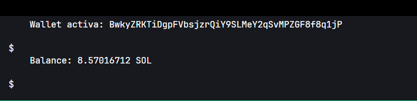
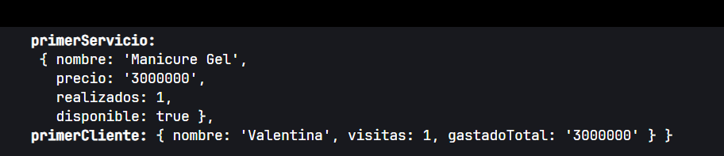
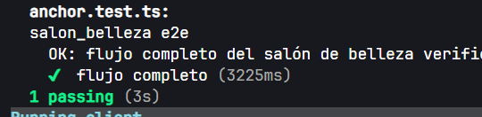

# 💅 Estética Glamour On-Chain — Gestión de Salón de Belleza en Solana

Programa inteligente (Smart Contract) desarrollado en **Rust** con el framework **Anchor** sobre la blockchain de **Solana (Devnet)**. Permite administrar de forma descentralizada, transparente e inmutable el catálogo de servicios, la base de clientes y el historial de atenciones de un salón de belleza.

- **Program ID (Devnet):** `9zvgE4ipWXMGQdTuVfQh4herMB2FvEGVAjbhW9xeTtAq`
- **Cuenta PDA del Salón:** `6JULy1Lotyj2ZQwfq3QPxDU6RaDRm517V214ot8trHwD`
- **Wallet Propietaria (Owner):** `BwkyZRKTiDgpFVbsjzrQiY9SLMeY2qSvMPZGF8f8q1jP`
- **Ver contrato en Solana Explorer (Devnet):** [Explorar Program ID](https://explorer.solana.com/address/9zvgE4ipWXMGQdTuVfQh4herMB2FvEGVAjbhW9xeTtAq?cluster=devnet)
- **Ver cuenta PDA en Solana Explorer (Devnet):** [Explorar Estado PDA](https://explorer.solana.com/address/6JULy1Lotyj2ZQwfq3QPxDU6RaDRm517V214ot8trHwD?cluster=devnet)
- **Probar en Solana Playground:** [Abrir proyecto en SolPG](https://beta.solpg.io/github.com/melek-eyzaguirre-dev/Estetica-Glamour-Solana)

---

## 🎯 Propósito y Problema que Resuelve (Dolor que Cura)

- **¿Qué dolor cura?** Elimina la pérdida de registros, la falta de trazabilidad en las atenciones diarias y la dependencia de cuadernos físicos o sistemas centralizados costosos. Garantiza que cada servicio prestado, actualización de tarifas y visita de cliente quede respaldado criptográficamente en la blockchain, evitando alteraciones no autorizadas por terceros.
- **¿A quién está orientado?** A **estilistas independientes, salones de belleza, centros de estética, barberías y estudios de manicure** que buscan digitalizar su operación, medir la demanda real por servicio y mantener un historial verificable de fidelización de clientes sin intermediarios.

---

## 🏗️ Arquitectura e Instrucciones

El contrato utiliza una **PDA (Program Derived Address)** determinística derivada con las semillas `["salon_belleza", owner]`, asegurando que cada propietario tenga una única cuenta aislada y que solo su wallet (`Signer`) pueda modificar el estado.

- `crear_salon`: Inicializa la cuenta PDA del salón asociada al propietario.
- `agregar_servicio` / `eliminar_servicio`: Gestiona el catálogo de servicios (nombre y precio en lamports).
- `alterar_servicio` / `actualizar_precio`: Activa o pausa la disponibilidad de un servicio y actualiza tarifas.
- `registrar_cliente`: Incorpora nuevos clientes al registro del salón.
- `registrar_atencion`: Registra una atención realizada, incrementando el contador de servicios prestados (`realizados`), las visitas del cliente (`visitas`) y su gasto acumulado (`gastado_total`), emitiendo eventos on-chain (`AtencionRegistrada`).

---

## ✅ Evidencia de Funcionamiento en Solana Devnet

###  Log de Ejecución del Cliente (`client.ts`) y Eventos Emitidos

```text
Wallet activa: BwkyZRKTiDgpFVbsjzrQiY9SLMeY2qSvMPZGF8f8q1jP
Balance: 8.57016712 SOL
Salón de Belleza PDA: 6JULy1Lotyj2ZQwfq3QPxDU6RaDRm517V214ot8trHwD
-- crear_salon: ya existe, continuando...
-- agregar_servicio
Evento ServicioAgregado: { nombre: 'Corte y Brushing', precio: '2000000', slot: 525296939 }
-- registrar_cliente
Evento ClienteRegistrado: { nombre: 'Camila', slot: 525296942 }
-- registrar_atencion
Evento AtencionRegistrada: {
  cliente: 'Camila',
  servicio: 'Corte y Brushing',
  cantidad: 1,
  total: '2000000',
  slot: 525296945
}
Resumen estado: {
  nombre: 'Estética Glamour',
  clientes: 3,
  primerServicio: {
    nombre: 'Manicure Gel',
    precio: '3000000',
    realizados: 1,
    disponible: true
  },
  primerCliente: {
    nombre: 'Valentina',
    visitas: 1,
    gastadoTotal: '3000000'
  }
}
```
### 3. Capturas de Pantalla (Evidencia Visual)

#### Wallet Activa y Balance en Devnet


#### Registro de Clientas y Estado On-Chain


#### Pruebas End-to-End (`anchor.test.ts` — 1 passing)


#### Transacciones Confirmadas en Devnet


